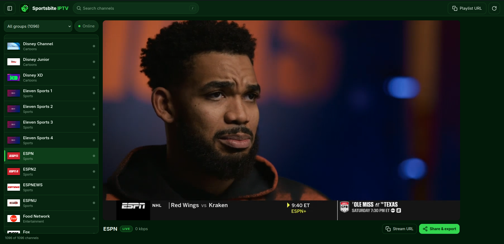
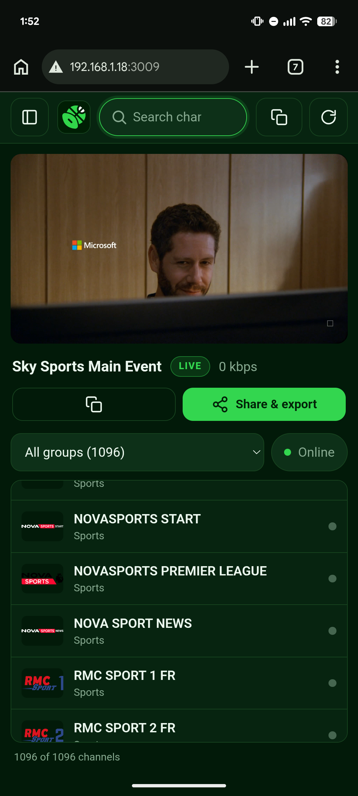

<div align="center">

# 🏟️ sportsbite-hls-proxy

**Self-hosted Sportsbite IPTV web viewer · HLS proxy · dynamic M3U8 playlist generator**

[](https://github.com/Lunatic16/sportsbite-hls-proxy/actions/workflows/ci.yml)
[](#-quick-start)
[](https://nodejs.org)
[](https://www.typescriptlang.org)
[](LICENSE)
[](../../pulls)

TypeScript · Node.js 20+ · Fastify · undici · hls.js

</div>
<p align="center">
  
  <br/>
  
</p>


Plays channels in the browser with **hls.js** and serves **signed proxy URLs** that any IPTV app — VLC, TiviMate, IPTVnator, Kodi — can consume over your LAN. It keeps working even when the origin requires custom headers, blocks CORS, rotates short-lived segment tokens, or smuggles MPEG-TS through an image CDN.

## ✨ Highlights

- 📡 **Real HLS proxy** — master & media playlists, AES-128/SAMPLE-AES keys, fMP4 init segments, LL-HLS parts, subtitles. Segments are **streamed, never fully buffered**
- 🧩 **Pluggable resolvers** — `static`, `m3u-source` and custom implementations; the built-in `sportsbite` resolver needs nothing but a Firefox User-Agent
- 📋 **Dynamic M3U8 playlist** — `/playlist.m3u8` with `?group=`, `?search=`, `?format=m3u|m3u8`, `?download=1`; entries always point at *your* server, never at expiring upstream URLs
- 🔗 **Share & export panel** — live/M3U8/direct URLs, expiry countdown + refresh, VLC & MPV commands, QR codes, per-channel rotating share tokens
- 🥸 **timst unwrapping** — TikTok-CDN-disguised MPEG-TS detected and decoded per response, transparently
- 🔒 **Secure by default** — SSRF guard with DNS-rebinding protection, HMAC-signed proxy URLs, per-channel share tokens, secrets redacted from logs
- 🐳 **Docker-native** — multi-stage build, non-root, read-only rootfs, healthcheck, optional Caddy auto-HTTPS

<details>
<summary>📖 <strong>Full feature tour</strong></summary>

- **HLS proxy** — master playlists, media playlists, AES-128/SAMPLE-AES keys, fMP4 init segments, LL-HLS parts/preload-hints, subtitles. Relative URIs are resolved against the **final** (post-redirect) upstream URL. Segments are **streamed, never fully buffered** (decoded `timst` segments are the one deliberate exception — they must be reassembled).
- **Pluggable resolvers** — `static` (fixed URL), `m3u-source` (looks the URL up in a source playlist at play time) and `custom` implementations. The built-in `sportsbite` resolver derives stream URLs from the channel id prefix (`247-` / `t247-` / `cv-`) and needs nothing but a Firefox User-Agent. Resolved URLs are cached until `expiresAt` and re-resolved automatically on upstream 403/404/410.
- **Dynamic M3U8 playlist** — `GET /playlist.m3u8` with `?group=`, `?search=`, `?format=m3u|m3u8`, `?download=1`. Entries always point at this server (never at expiring upstream URLs). The base URL comes from the request `Host` (or `X-Forwarded-*` with `TRUST_PROXY`, or `PUBLIC_BASE_URL`), so LAN clients get reachable addresses.
- **Share & export panel** — per channel: a stable Live URL, the M3U8 stream URL, the raw Direct URL with an expiry countdown + refresh, shell-escaped VLC / MPV commands (POSIX, PowerShell, cmd.exe variants) with a Live/Direct source toggle, a QR code, and per-channel rotating share tokens.
- **timst unwrapping** — TikTok-CDN-disguised TS (fake RIFF/JPEG/PNG header, or `TIKTIKPX` pixel-PNG with gzipped TS in the pixel data) is detected **per response** and decoded transparently. TikTok's CDN 403s any request carrying a `Referer`, so Referer/Origin are stripped for hosts matching `STRIP_REFERER_HOSTS`.
- **Security** — SSRF guard (loopback / private / link-local / CGNAT / metadata ranges blocked unless `ALLOW_PRIVATE_UPSTREAMS=true`, IPv4-mapped IPv6 and NAT64 forms included, DNS validated at connect time), HMAC-signed proxy URLs that cannot be tampered with, per-channel share tokens that cannot open another channel or the admin API, sensitive headers never present in URLs, optional global `AUTH_TOKEN`, secrets redacted from logs.
- **Docker** — multi-stage build, non-root, read-only rootfs, healthcheck, resource-limit examples, optional Caddy automatic-HTTPS profile.

</details>

## 📑 Contents

[✨ Highlights](#-highlights) · [🚀 Quick start](#-quick-start) · [📺 IPTV players](#-using-it-in-iptv-players) · [📥 Adding channels](#-adding-channels) · [⚙️ Configuration](#-configuration) · [🔗 Share panel](#-share-and-export-panel) · [🔌 API](#-api) · [🔒 Security](#-security-notes) · [🩺 Troubleshooting](#-troubleshooting) · [🛠️ Development](#-development) · [📄 License](#-license) · [🙏 Credits](#-credits)

## 🚀 Quick start

Two equal paths to the same destination — the web UI on **:3000** and an IPTV playlist at `http://<your-lan-ip>:3000/playlist.m3u8`.

|  | 🐳 Docker | 🟢 Node.js |
|---|---|---|
| **Prerequisites** | Docker Engine + compose plugin | Node.js 20+ |
| **Get the code** | `git clone https://github.com/Lunatic16/sportsbite-hls-proxy`<br>`cd sportsbite-hls-proxy` | ← same |
| **Configure** | optional — `cp .env.example .env` | ← same |
| **Channels** | first start seeds `data/channels.json` from `channels.example.json`; bind your own list or import after up — see [📥 Adding channels](#-adding-channels) | `npm run import -- https://sportsbite.org/channels` |
| **Run** | `docker compose -f docker-compose.yml up -d` (plain `up` merges the dev override — see below) | `npm run dev` (hot reload) · or `npm run build && npm start` |
| **Verify** | `docker ps` → STATUS `healthy` · `docker compose logs -f` | open `http://localhost:3000/` |

> 💡 On first start the app creates `data/`; if `data/channels.json` is missing it is seeded from `channels.example.json`. If `PROXY_SECRET` is not set, one is generated and persisted to `data/secret`.

Open `http://localhost:3000/` — pick a channel, hit play. The playlist for IPTV apps is at `http://<your-lan-ip>:3000/playlist.m3u8`.

<details>
<summary>🐳 <strong>Advanced Docker</strong> — persistence, LAN reachability, auto-HTTPS, multi-arch</summary>

- **Mutable state lives in `./data`** (bind-mounted to `/app/data`) — `channels.json`, share-token secrets and the proxy secret survive `docker compose down && up`.
- **Bind your own channel list:** `volumes: ["./channels.json:/app/data/channels.json:ro"]` (already shown, commented, in `docker-compose.yml`).
- **Behind a reverse proxy** set `PUBLIC_BASE_URL=http://<lan-ip>:3000` (or your domain) and `TRUST_PROXY=true`.
- **LAN access from another device** — nothing special is needed inside Docker: the `Host` header the client sends still names your server, so generated playlist/share URLs carry the right address. If you must pin it, set `PUBLIC_BASE_URL`. `network_mode: host` also works on Linux and makes discovery trivial, at the cost of container isolation and port-collision safety.
- **Automatic HTTPS** via the bundled Caddy profile:

  ```bash
  SITE_ADDRESS=tv.example.com PUBLIC_BASE_URL=https://tv.example.com TRUST_PROXY=true \
    docker compose --profile proxy up -d
  ```

  The sample `Caddyfile` disables response buffering (`flush_interval -1`) and sets long timeouts, which matters for streaming.
- **Multi-arch build:**

  ```bash
  docker buildx build --platform linux/amd64,linux/arm64,linux/arm/v7 \
    -t <you>/sportsbite-hls-proxy:latest --push .
  ```

- npm helpers: `npm run docker:build` · `docker:up` · `docker:logs` · `docker:down`.
- **Image size:** ~190 MB — the Node binary (~100 MB) dominates; `hls.js` and `qrcode-generator` are devDependencies (bundled into the static web bundle at build time) so they never reach the runtime layer, and the runtime stage is bare Alpine + the Node binary rather than a full `node:20-alpine`.
- **Verified live:** container reaches `healthy` within seconds of start, runs as `uid=1000(node)`, and `channels.json` + `data/tokens.json` + `data/secret` survive `down && up` byte-identical.

> ℹ️ Plain `docker compose up` **auto-merges `docker-compose.override.yml`** (dev mode: bind-mounted sources, hot reload, inspector port). For production pin the file explicitly: `docker compose -f docker-compose.yml up -d`.

</details>

## 📺 Using it in IPTV players

Point any player at **`http://<server-ip>:3000/playlist.m3u8`** — add `?token=<AUTH_TOKEN>` if you set one (players cannot send headers, so the query parameter is the portable form).

| Player | Setup |
|---|---|
| **VLC** | Media ▸ Open Network Stream — or straight from the Share panel: `vlc '<url>'`. For raw Direct URLs the panel adds `--http-user-agent=… --http-referrer=…` when the channel needs them |
| **TiviMate / OTT Navigator** | Add playlist ▸ XStream/URL — the *Dynamic M3U8 Stream URL* from the Share panel for a single channel, or the full `/playlist.m3u8`. EPG URL: `/epg.xml` |
| **IPTVnator** | Add playlist by URL — same address |
| **Kodi** | PVR IPTV Simple Client ▸ M3U Play List URL + XMLTV URL `/epg.xml` |

All generated links are signed and LAN-reachable (derived from the request `Host`); `PUBLIC_BASE_URL` overrides when needed.

## 📥 Adding channels

Edit `data/channels.json` (hot-reloaded) or import from the command line:

```bash
npm run import -- https://sportsbite.org/channels      # live sportsbite catalog → custom sportsbite resolver
npm run import -- /path/to/list.m3u                    # M3U → static channels
npm run import -- /path/to/list.m3u --as-m3u-source    # M3U kept in data/source.m3u → m3u-source channels
npm run import -- channels.json --replace              # replace instead of merge

npm run check -- --id=247-beinsportsus                 # probe: playlist + first segment bytes
npm run check -- --group=Sports --limit=20             # targeted sweep (a full 1000+ sweep trips upstream rate limits)
```

<details>
<summary>🗂️ <strong>Channel model & resolvers</strong></summary>

```json
{
  "id": "247-beinsportsus",
  "name": "beIN SPORTS USA",
  "group": "Sports",
  "logo": "https://raw.githubusercontent.com/tv-logo/tv-logos/main/countries/united-states/bein-sports-us.png",
  "tvgId": "247-beinsportsus",
  "resolver": "custom",
  "options": { "custom": "sportsbite" }
}
```

- `resolver: "static"` — `url` (+ optional `headers`: `User-Agent`, `Referer`, `Origin`, `Cookie`, `Authorization`, arbitrary). Headers are stored server-side and referenced by short ID in proxy URLs — they never appear in links or logs.
- `resolver: "m3u-source"` — `options: { source: "./data/source.m3u" | URL, match: { tvgId } | { name } }`. The source is re-read (with a short cache) at resolve time, so regenerated upstream playlists keep working.
- `resolver: "custom"` — `options.custom` names a registered implementation. The built-in `sportsbite` resolver maps `247-`/`t247-`/`cv-` prefixes to `https://sportsbite.org/{247,t247,cv}/<slug>`. To add your own scraper/token resolver, copy the pattern in `src/resolvers/custom.example.ts`, register it in `src/resolvers/index.ts` via `registerResolver('name', impl)`, and return `{ url, headers, expiresAt }`.

</details>

## ⚙️ Configuration

Everything is environment-driven (`.env`, see `.env.example`) — and every value has a default.

<details>
<summary>📋 <strong>Full environment variable reference</strong></summary>

| Variable | Default | Meaning |
|---|---|---|
| `PORT` / `HOST` | `3000` / `0.0.0.0` | Listen address |
| `PUBLIC_BASE_URL` | – | Force the base URL used in generated links (reverse proxy) |
| `TRUST_PROXY` | `false` | Honor `X-Forwarded-Proto`/`-Host` |
| `PROXY_SECRET` | auto-generated | HMAC secret for signed proxy URLs (persisted to `data/secret`); `*_FILE` variants supported |
| `AUTH_TOKEN` | – (open LAN mode) | Global token for UI/API/playlist; header, `x-auth-token`, or `?token=` |
| `SHARE_TOKEN_TTL` | `0` (never) | Per-channel share token lifetime in seconds |
| `SHARE_TOKEN_REQUIRED` | `false` | Require a share token on `/live` and `/stream` |
| `CACHE_TTL_PLAYLIST_MS` / `CACHE_TTL_VOD_MS` | `1000` / `60000` | Upstream playlist micro-cache (live playlists must stay fresh — tokens rotate) |
| `SEG_CACHE_TTL_MS` / `SEG_CACHE_MAX_MB` | `0` / `256` | Optional decoded-segment micro-cache so player retries don't re-hit a dead URL |
| `REQUEST_TIMEOUT_MS` / `CONNECT_TIMEOUT_MS` | `15000` / `5000` | Upstream timeouts |
| `MAX_RETRIES` / `MAX_REDIRECTS` | `2` / `8` | Retry 5xx/network resets with backoff; redirect cap (each hop SSRF-checked) |
| `ALLOW_PRIVATE_UPSTREAMS` | `false` | Set `true` only if an upstream really lives on your LAN or another container |
| `STRIP_REFERER_HOSTS` | `tiktokcdn` | Host substrings that must never receive Referer/Origin |
| `USER_AGENT` | Firefox UA | Default upstream UA |
| `UPSTREAM_MAX_BODY_MB` / `UNWRAP_MAX_BUFFER_MB` | `8` / `64` | Playlist read cap / wrapped-segment decode cap |
| `RESOLVE_TTL_MS` / `RESOLVE_TIMEOUT_MS` | `300000` / `10000` | Resolver cache + timeout |
| `DATA_DIR` / `CHANNELS_FILE` | `./data` / `$DATA_DIR/channels.json` | Storage |
| `LOG_LEVEL` | `info` | pino level |

</details>

## 🔗 Share and export panel

Every channel gets a panel in the web UI with five copyable options.

<details>
<summary>🔗 <strong>What's in the panel</strong></summary>

1. **Our Live URL** (`{base}/live/<id>?token=<shareToken>`) — recommended; re-resolves expired upstream URLs on every request, so the link never goes stale.
2. **Dynamic M3U8 Stream URL** (`{base}/stream/<id>.m3u8?token=...`) — the URL the generated playlist uses.
3. **Direct URL** — the raw upstream URL with an expiry countdown (from the resolver's `expiresAt`; "Expiry unknown" if absent) and a Refresh button. Returned only to authenticated callers and never logged; `Cookie`/`Authorization` are redacted from the response.
4. **VLC** command with POSIX / PowerShell / cmd.exe variants and a Live/Direct toggle.
5. **MPV** command with `--user-agent`, `--referrer`, `--http-header-fields='Origin: ...'` as needed.

**Regenerate token** rotates that channel's secret (`data/tokens.json`) and kills its old links. Share tokens are bound to a single channel: a token for A gets **403** on B and **401** on `/api/*`.

</details>

## 🔌 API

<details>
<summary>🗂️ <strong>Route reference</strong></summary>

| Route | Purpose |
|---|---|
| `GET /health` | Status JSON (always open) |
| `GET /playlist.m3u8` (`.m3u`, `/playlist`) | Generated IPTV playlist (`?group=&search=&format=&download=1`) |
| `GET /epg.xml` | XMLTV channel stub |
| `GET /stream/:id.m3u8` | Channel entry point (re-resolve + retry built in) |
| `GET /live/:id` | Alias without extension (share links) |
| `GET /proxy/playlist?url=&h=&s=` | Signed playlist proxy |
| `GET /proxy/segment?url=&h=&s=` | Signed segment proxy (Range passthrough, per-response unwrap) |
| `GET /proxy/key?url=&h=&s=` | Signed key proxy |
| `GET /api/channels[?group=&search=]` | Channel list (sanitized — no headers) |
| `GET /api/channels/:id` | Single channel + its stream/live URLs |
| `GET /api/channels/:id/share` | live/m3u8/direct/vlc/mpv payload |
| `POST /api/channels/:id/refresh` | Force re-resolve (Direct URL refresh) |
| `POST /api/channels/:id/rotate-token` | Rotate the channel's share secret |
| `POST /api/channels/:id/invalidate` | Drop the cached resolved URL for one channel |
| `POST /api/reload` | Re-read channels.json + clear caches |

</details>

## 🔒 Security notes

<details>
<summary>🛡️ <strong>SSRF, URL signing, header hygiene & auth</strong></summary>

- **SSRF** — only `http`/`https` upstreams; loopback, private, link-local, CGNAT, benchmark, multicast and cloud-metadata ranges are rejected (URL literals *and* every resolved IP at connect time, closing DNS rebinding). Docker host gateway (`172.17.0.1`) and `169.254.169.254` are covered by the private/link-local rules. `ALLOW_PRIVATE_UPSTREAMS=true` is the documented escape hatch for LAN/container upstreams.
- **Signed proxy URLs** — `url` is base64url, `s` is an HMAC-SHA256 over `kind|url|headersId`. Tampering with any part, or replaying a playlist URL as a segment/key, fails verification.
- **Header hygiene** — channel headers live in a server-side registry keyed by short ID. `Cookie`/`Authorization` are stripped on cross-origin redirects; Referer/Origin are stripped for `STRIP_REFERER_HOSTS` (TikTok CDN 403s on Referer). Logs carry redacted URLs (no `url`/`s`/`token` values) and never header values.
- **Auth** — `AUTH_TOKEN` guards UI/API/playlist. Share tokens are per-channel HMACs; when `SHARE_TOKEN_REQUIRED=true`, `/live` and `/stream` demand a valid per-channel token. Proxy routes are protected by signature, not token. In open LAN mode (no tokens) the server is meant for a trusted network — scope it accordingly or put auth in front.

</details>

## 🩺 Troubleshooting

<details>
<summary>🩹 <strong>Common issues & fixes</strong></summary>

- **CORS errors in the browser** — the proxy adds `Access-Control-Allow-Origin: *` and answers preflight on `/proxy/*` and API routes. If you see CORS errors, you are probably pointing hls.js at an **upstream URL directly** instead of the proxy/stream URL. Always use `/stream/<id>.m3u8` or the share links.
- **403 from upstream on one channel** — usually an expired/absent header (check the channel's `headers`) or the origin fingerprinting. A stale-token 403/404 on segments is *expected* upstream behavior: players re-poll the playlist and the proxy re-issues fresh segment URLs on every refresh; the share/stream entry points re-resolve and retry once automatically.
- **"Channel only works after opening it in the webapp once"** — one-shot players fail on a single upstream hiccup. The retry ladder lives in `/live` and `/stream`; make sure the player points at those, not a raw URL.
- **Expired tokens / stale links** — Live and M3U8 links keep working by design. Direct URLs expire with the upstream (watch the countdown, hit Refresh). Regenerating a token deliberately kills old links.
- **cv-* channels / 503 upstream** — the `cinevid` upstream was dead at build time (HTTP 503 "cinevid streamUrl missing") and the origin also rate-limits aggressive sweeps. `npm run check` marks those offline; the proxy surfaces a clean 502 JSON. Channels are re-checked, not assumed.
- **Docker unhealthy** — the healthcheck probes `http://127.0.0.1:$PORT/health` (IPv4-safe); verify `PORT` is set in `environment:` (the compose ports mapping alone does not set it), and check `docker compose logs`.
- **No LAN reachability** — set `PUBLIC_BASE_URL=http://<lan-ip>:3000`, or check firewall rules; the app itself binds `0.0.0.0`.
- **"web UI not built"** — run `npm run build:web` (the Docker image builds it in-stage).

</details>

## 🛠️ Development

```bash
npm run dev          # tsx watch + esbuild'd web UI
npm run test         # vitest (rewriter, SSRF, signing, share tokens, playlist gen, shell escaping, unwrap, import)
npm run typecheck    # tsc --noEmit (strict)
npm run lint         # eslint (flat config) + prettier rules
npm run format       # prettier
```

<details>
<summary>🏗️ <strong>Project layout & design decisions</strong></summary>

Layout: `src/routes` (proxy/stream/playlist/share/api) · `src/hls` (parser/rewrite/unwrap/playlistService/mime) · `src/resolvers` (types/static/m3uSource/sportsbite + custom example) · `src/channels` (store/import) · `src/net` (fetchUpstream/ssrf/sign/headerRegistry/shareStore) · `src/util` · `web/` (index.html, app.ts, style.css) · `tests/`.

Design decisions worth knowing: live playlists are micro-cached for 1 s so a sliding window never serves stale tokens; decoded segments are the only fully-buffered bodies (bounded by `UNWRAP_MAX_BUFFER_MB`); the header registry is in-memory (a restart re-registers on the next resolve); segment/key proxy URLs are re-issued on every playlist refresh rather than carrying an expiry of their own — their effective lifetime equals the upstream token lifetime embedded in each URL.

</details>

## 📄 License

Released under the [MIT License](LICENSE).

## 🙏 Credits

Stream derivation, token behavior, TikTok wrapper formats and header rules come from the project's upstream research notes (re-verified 2026-10-19 against sportsbite.org). This project is a self-hosted viewer for personal use — respect the upstream providers and your local laws.
